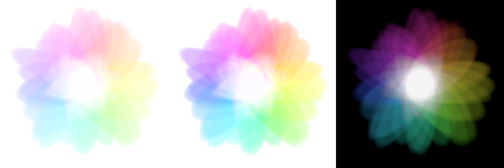

# additive-light-art

光の重ね合わせアート — 36 枚の色の楕円が、すべて同じ一点で重なる。



左から: 白地用 soft / 白地用 bright / 黒地の本当の加算光。

## What it is

- 36 ellipses, hues evenly spaced around the colour wheel, each slightly
  jittered in angle, length, width and offset (seed `20261004`).
- Every ellipse contains the common centre, so all 36 overlap there.
- Light is **added in linear RGB**, clipped, and only then encoded to sRGB.
  Where all hues stack, the result is white light. This is
  `samples/additive_black.png`.
- White fabric cannot emit light, so the white-ground images are a
  **print translation**, not additive light: each pixel's departure from
  neutral (its brightest channel minus each channel) becomes ink, solved
  as an RGBA layer that reproduces `white − ink` exactly when composited on
  white. Neutral pixels — the empty ground and the full-overlap centre —
  carry no ink. `pigment_boost` 0.70 gives `white_soft.png`, 1.24 gives
  `white_bright.png`.

## Generate

```
pip install -r requirements.txt
python generate.py                 # writes samples/ at 2900 x 2900
python generate.py --size 6000 --out big
python generate.py --seed 1        # a different flower
```

Options: `--seed`, `--size` (pixels), `--extent` (half-width of the canvas in
ellipse units; default 1.70, the petals need 1.594), `--out`.

Output is deterministic for a given seed. Across numpy versions a handful of
pixels may differ by 1/255 from floating-point rounding.

## Files

| path | contents |
|---|---|
| `generate.py` | the generator (numpy + Pillow only) |
| `samples/additive_black.png` | true additive light on black, RGB |
| `samples/white_soft.png` | white-ground print translation, gentle, RGBA |
| `samples/white_bright.png` | white-ground print translation, vivid, RGBA |
| `samples/preview.jpg` | the three side by side |

## Licence

- **Code** (`generate.py`): [0BSD](LICENSE).
- **Design and images** (the artwork defined by `generate.py` and every image
  it produces, including everything in `samples/`): [CC0 1.0 Universal](LICENSE-CC0) —
  dedicated to the public domain.

## Defensive publication

This repository is published as prior art. The design — coloured ellipses
sharing one common point, summed as linear-RGB light, together with its
white-ground print translation by chromatic departure — and the code that
produces it are disclosed here so that they remain free for anyone to use.
The Git history and its archive in Software Heritage record the date.
