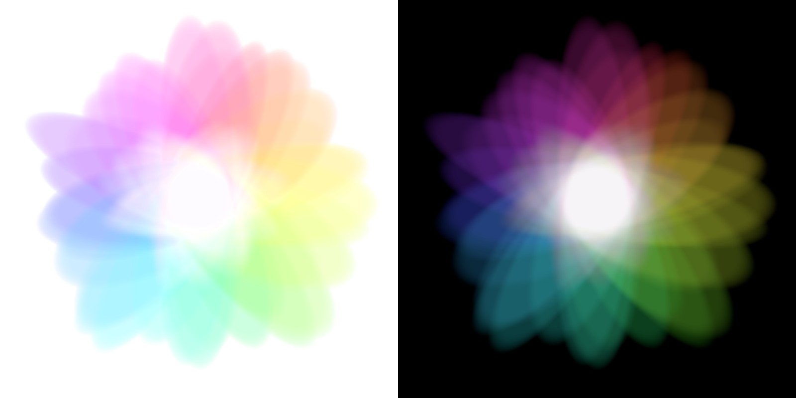
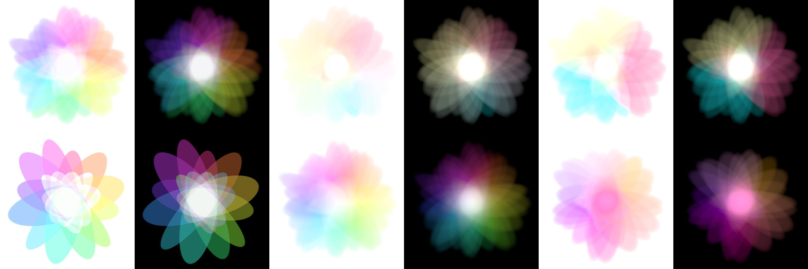

# additive-light-art

光の重ね合わせアート — 色の楕円がすべて同じ一点で重なるイラストの生成器。



左: 白地版 (paper) / 右: 黒地の加算光 (light)。

## What it is

- Coloured ellipses arranged once around a circle, each slightly jittered in
  angle, length, width and offset (default seed `20261004`, 36 ellipses).
- **Every ellipse contains the common centre**, so all of them overlap
  there. This holds for every parameter setting: the script computes each
  ellipse's weight at the centre and refuses to render if any is zero.
- Light is **added in linear RGB**, clipped, and only then encoded to sRGB.
  Where every hue stacks, the result is white light (`*_light.png`).
- A white ground cannot be lit further, so the white version
  (`*_paper.png`) is a translation, not additive light: each pixel's
  departure from neutral (its brightest channel minus each channel)
  becomes colour, solved as an RGBA layer that reproduces it exactly when
  composited on white. Neutral pixels — the empty ground and the
  full-overlap centre — stay white.
- The canvas is sized automatically so no petal is cut off at the edge.

## Generate

```
pip install -r requirements.txt
python generate.py                              # samples/art_*.{png,jpg}, 2900 x 2900
python generate.py --name mine --seed 7         # a different flower
```

| option | effect | default |
|---|---|---|
| `-n`, `--count` | number of ellipses | 36 |
| `--colors` | `rainbow`, or hex stops `'#ff2a6d,#05d9e8,#f9f871'` forming a closed gradient (blended in linear RGB) | `rainbow` |
| `--steps` | number of distinct colours; `0` keeps the gradient continuous | 0 |
| `--saturation`, `--hue-start` | rainbow only | 0.93, 0.035 |
| `--softness` | width of each petal's faded rim, `0 < s < 1.11`; small = crisp edges | 0.36 |
| `--falloff` | `0..1`, dims each petal from its own centre toward its rim | 0 |
| `--gain` | overall brightness (already normalised for `--count`) | 1 |
| `--ink` | colour strength of the paper version | 1 |
| `--size` | pixels per side | 2900 |
| `--seed` | random seed for the jitter | 20261004 |
| `--extent` | canvas half-width in ellipse units | fit all petals |
| `--out`, `--name` | output folder and file prefix | `samples`, `art` |

Each run writes `<name>_light.png` (RGB), `<name>_paper.png` (RGBA,
transparent ground) and `<name>_preview.jpg`.

Output is deterministic for a given set of options. Across numpy versions a
handful of pixels may differ by 1/255 from floating-point rounding.

### Variants



Top, left to right:

```
python generate.py --steps 6
python generate.py --colors '#ff2a6d,#05d9e8,#f9f871'
python generate.py --colors '#ff2a6d,#05d9e8,#f9f871' --steps 3
```

Bottom, left to right:

```
python generate.py -n 12 --softness 0.06
python generate.py --falloff 0.8 --gain 1.4
python generate.py --colors '#ff7b00,#ff0055,#6a00ff' -n 24 --falloff 0.5
```

(each with `--size 1200`). The centre is white only when the colours add
up to white; a palette without green, like the last one, meets in pink.

## Licence

- **Code** (`generate.py`): [0BSD](LICENSE).
- **Design and images** (the artwork defined by `generate.py` and every image
  it produces, including everything in `samples/`): [CC0 1.0 Universal](LICENSE-CC0) —
  dedicated to the public domain.

## Defensive publication

This repository is published as prior art. The design — coloured ellipses
that all contain one common point, summed as linear-RGB light, together with
its white-ground translation by chromatic departure — and the code that
produces it are disclosed here so that they remain free for anyone to use.
The Git history and its archive in Software Heritage record the date.
